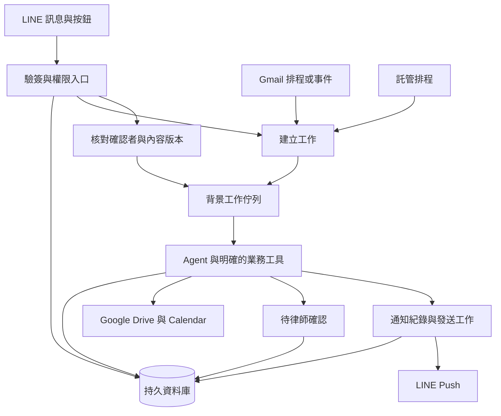

# 雲端部署的第一輪比較

查證日期：2026-11-03。狀態為官方文件研究，尚未部署、測量資源或建立付費服務。適用地區、帳號及價格需在候選驗證時固定。

## 先固定需要長期保存的狀態

LINE webhook 只負責驗簽、辨識來源與持久接收。排程掃信、OCR、Agent 執行及通知走背景工作。等待律師確認時保存資料並結束當次運算，不維持一個 HTTP 連線數小時等待。

案件、待辦、工作進度、待確認操作與通知紀錄保存在持久資料庫。正式文件以 Drive 為主，暫存與衍生索引依資料政策管理。容器記憶體、函式區域變數與本機暫存不能作為唯一狀態來源。

以下是共同研究架構，不是已部署結果。

資料庫與佇列之間的中斷需可恢復，例如先在同一資料庫交易記錄事件與待派送工作，再由工作者派送。這是設計方向，不宣稱平台提供跨 Google、LINE 的原子交易。

## 部署組合

| 組合 | 官方已確認的特性 | 本案研究判斷 |
| --- | --- | --- |
| Google Cloud Run 加託管資料庫、Cloud Tasks、Cloud Scheduler | Cloud Run 支援容器。預設請求式 CPU 不適合回應後任意留背景執行。[計費與 CPU](https://docs.cloud.google.com/run/docs/configuring/billing-settings) | 適合明確 API 與分段工作，Google 授權仍需自行處理。不可在 webhook 回應後只開一個執行緒便視為可靠。 |
| Render 付費 Web Service、Background Worker、Postgres 與 Cron | Worker 持續處理佇列，Cron 可排程但不能掛持久磁碟。[Worker](https://render.com/docs/background-workers)、[Cron](https://render.com/docs/cronjobs) | 適合先做可理解的單服務與背景工作部署。正式資料放 Postgres，不把免費或本機磁碟當可靠基礎。 |
| Azure Container Apps 加持久資料庫、佇列與 Jobs | Jobs 支援手動、排程及事件驅動，與接 HTTP 的 App 分開。[Jobs](https://learn.microsoft.com/en-us/azure/container-apps/jobs) | Microsoft Agent Framework 或既有 Azure 環境可比較此路線，不因框架而自動需要 Azure。 |
| AWS AgentCore 加資料庫與排程 | 計算環境有生命週期，microVM 與 Instances 條件不同。[Session](https://docs.aws.amazon.com/bedrock-agentcore/latest/devguide/runtime-sessions.html) | Strands 等可研究託管隔離，但不是永久執行的排程服務。案件狀態不能只放在 live session。 |
| Vercel Functions 加 Workflow 與持久資料庫 | 一般函式有執行時限，Workflow 是另一層可等待及恢復的機制。[函式限制](https://vercel.com/docs/functions/limitations) | TypeScript 路線可比較，但不能把 AI SDK 等同 Vercel 託管或 Workflow。 |
| LangSmith Deployment | 提供 Agent Server 與託管工作流程，可採 Cloud 或其他部署方式。[部署文件](https://docs.langchain.com/langsmith/deployment) | LangGraph 或 deepagents 可比較託管便利性、資料區域與費用，自架雲端容器仍保留為替代。 |
| Google 託管 Agent Runtime | Google 平台提供 runtime、Session 與記憶等服務。[平台說明](https://docs.cloud.google.com/gemini-enterprise-agent-platform/agents) | ADK 的託管方向可比較，服務端支援不代表 SDK 的每項確認與恢復能力都已相容。 |

這些是可比較的架構方向，不代表每個框架與每個平台組合都已實測。Kubernetes 與自己管理 VM 暫不列起步首選，僅在隔離、網路或執行環境需求證明必要時重考。

## 執行時間與排程限制

Cloud Run Service 預設請求時限五分鐘，最高六十分鐘；若前面由其他服務呼叫，仍受該服務較短限制。[Cloud Run 時限](https://docs.cloud.google.com/run/docs/configuring/request-timeout) Cloud Tasks 的 HTTP handler 預設十分鐘、最高三十分鐘，不能只看 Cloud Run 設到六十分鐘。[Cloud Tasks](https://docs.cloud.google.com/tasks/docs/creating-http-target-tasks)

Cloud Run 現行文件另外列出可長時間執行的 Instance 與 Worker Pool 等選擇。Service 即使有 minimum instances 也可能被關閉，不能把常駐設定當作免恢復。[CPU 與生命週期](https://docs.cloud.google.com/run/docs/configuring/billing-settings)

Cloud Scheduler 是至少一次投遞，罕見情況可重複啟動。[排程語意](https://docs.cloud.google.com/scheduler/docs/overview) 每日提醒以排程 ID 與應執行時間去重，另外決定延遲後補發或略過，不能在每次重啟時直接再推播。

Vercel 文件列 Pro 與 Enterprise 一般最高八百秒，一千八百秒仍有 Beta 與執行環境條件。[函式限制](https://vercel.com/docs/functions/limitations) 幾天後才確認的工作不適合維持單一函式執行，需要 Workflow 或其他持久狀態與背景機制。

AgentCore 的 microVM 計算生命週期上限為八小時，Instances 可有最長十四天等不同配置；狀態續存與計算環境仍是不同概念。[生命週期](https://docs.aws.amazon.com/bedrock-agentcore/latest/devguide/runtime-lifecycle-settings.html) 提醒排程不能綁在這些生命週期內。

Render 官方明示免費服務不供正式環境使用。[免費方案限制](https://render.com/docs/free) 免費試跑可用於原型，但不作法務助理可靠性的驗收依據。

## 可靠執行機制先比較再選一種

起步可選由資料庫工作表與託管佇列執行的分段任務，也可使用框架對應的持久工作流程。不要把 Cloud Tasks、DBOS、Temporal、框架 checkpointer 全部無差別疊加。

DBOS 官方架構使用 Postgres 保存 workflow、step 與排程等狀態，程式可在不同部署環境執行。[DBOS 架構](https://docs.dbos.dev/architecture) 它是可比較的執行機制，不是自動保證 LINE 或 Calendar 的外部副作用只發生一次。外部操作仍須遵守目的端的去重與重試規則。

最小候選組合應只有一套明確的工作擁有者與狀態恢復方式。若框架已提供適用的 checkpoint，先驗證能否完成 F01、F02、F09，再決定是否加其他流程引擎。

## 成本估算方式

目前未取得實際案件量、附件量、模型選擇與部署區域，不提供假定精準的每月總價。以下是費用組成與估算前提，仍需在候選原型中補上查價與用量。

| 費用 | 需要的使用量與報價條件 |
| --- | --- |
| LINE | 收件人次、通知頻率、後台用量與臺灣方案。現行價格見 [LINE 研究](line-api-research.md)。 |
| 模型 | 各任務輸入輸出 token、重試、快取、模型與供應商費率。工具呼叫次數不能直接當模型請求次數。 |
| 運算 | 服務是否常駐、CPU、記憶體、執行秒數與併發。完整 CLI runtime 與 API 迴圈分開量測。 |
| 資料庫 | 方案、連線、備份、容量與保留天數。等待確認與檢查點也佔儲存。 |
| 文件與 OCR | 檔案容量、掃描頁數、暫存、下載與跨區傳輸。 |
| 檢索與記憶 | Embedding、索引更新、查詢與失效清理。第一版不預設必須另買向量資料庫。 |
| 排程與可靠執行 | 工作次數、步驟、歷史保存、託管流程引擎費用及額外維運。 |
| 追蹤與其他 | Log 量、trace、Secret 管理、網域與資料流量。 |

後續按低量、中量與較高量的相同假設估算，不用促銷額度代表正式成本。不先聲稱某一家最便宜。

## 本輪候選部署方向

先比較通用託管容器加 Postgres，以及 Cloud Run 分段任務兩種基準，理由是兩者可讓多個框架共用相同工具與資料設計。框架專屬託管服務保留作便利性對照，不以提供 Session 或 Memory 的名稱直接加分。

這是驗證優先順序，不是已選定供應商。候選定案前需要確認部署地區、資料處理設定、帳號授權、用量與故障恢復實測。
