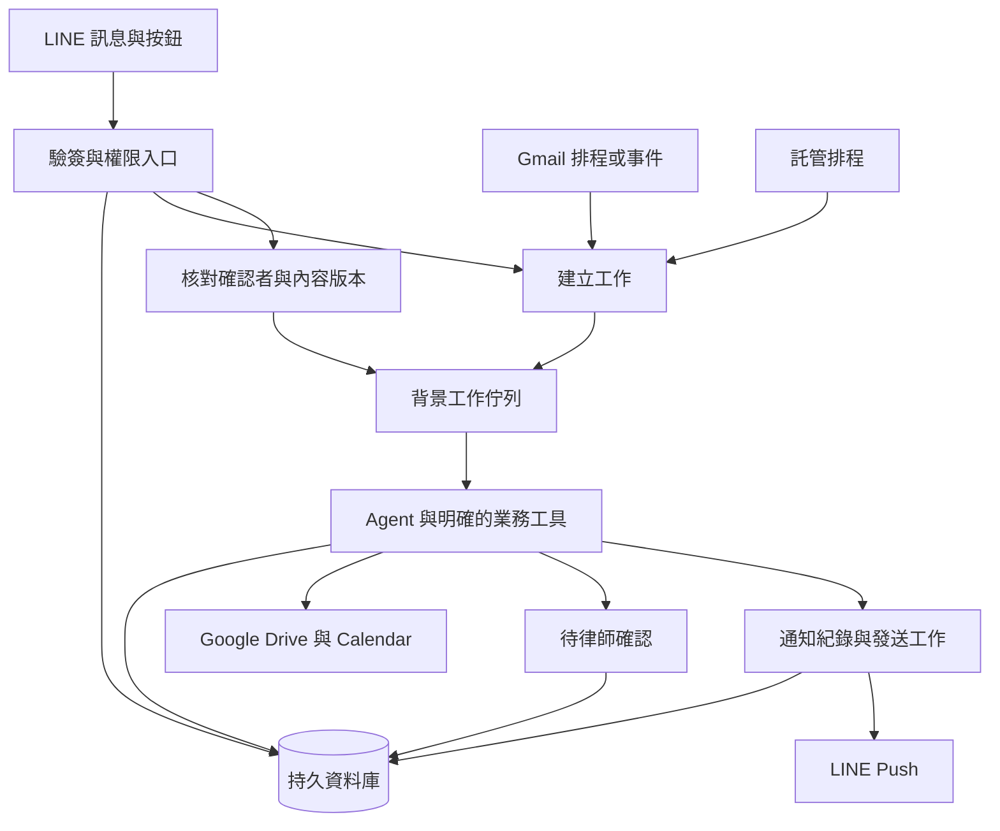

# 雲端部署的第一輪比較

初輪查證日期：2026-11-03。Cloudflare 補充查證與部署選型原則更新日期：2026-11-06。狀態為官方文件研究，尚未部署、測量資源或建立付費服務。適用地區、帳號及價格需在候選驗證時固定。

部署可行性是框架縮選的必要條件。每個候選都要提出能接收 LINE 事件、執行背景工作、等待律師確認及恢復工作的完整雲端組合，並記錄實際部署步驟。只有框架功能比較或本機範例成功，還不足以決定採用。

## 三種部署方案比較摘要

記錄日期為 2026-11-06。使用者希望優先選部署簡單的方案，目前先保存以下比較結果，尚未選定正式框架或部署平台。

使用者已確認採「客戶擁有雲端帳號與帳單，再授權代管」。下表按此條件整理，Render 已加計 Pro 工作區費用。第一個原型暫推薦 Cloudflare，Cloud Run 保留為備案，尚未因此決定正式採用。

| 方案與框架 | 資料庫 | 平台月費估算 | 含模型、基本 OCR 與 LINE 的月費 | 部署難度與暫定建議 |
| --- | --- | --- | --- | --- |
| Cloudflare 加 Vercel AI SDK 與 Workflows | D1 | 約 NT$160。 | 約 NT$1,700。 | 第一個原型。API 工具、背景工作與等待確認可集中在同一平台，先驗證套件與資料保存。 |
| Cloud Run 加 LangGraph、Cloud Tasks 與 Cloud Scheduler | 入門 Cloud SQL PostgreSQL | 約 NT$320 至 NT$480。 | 約 NT$1,900 至 NT$2,100。 | 備案。需要完整 Python、原生套件，或資料區域與網路條件更適合 GCP 時重比。 |
| Render Pro 加 Pydantic AI | 託管 Postgres | 約 NT$1,520。 | 約 NT$3,100。 | 保留比較。一般 Python 程式部署較直接，但客戶與代管者共同管理需計入 Pro 費用，恢復與去重仍須實作。 |

相同情境假設為一位律師、五個案件群組、每組四位收件人，每天二十項任務、每月 1,200 次模型呼叫、三百頁基本 OCR，以及六百三十則 LINE 計費訊息。模型暫以 Claude Sonnet 5.5 作計價範例，文件使用既有 Drive 空間。金額均未含稅、刷卡費與開發維護人力，以 US$1 等於 NT$32 的假設換算，非即時匯率。

GCP 使用美國 Iowa `us-central1` 價格，並非臺灣區報價。最小共享 CPU Cloud SQL 不含 Cloud SQL SLA；若改用下方試算的獨立 CPU 規格，整體月費約 NT$3,300 至 NT$3,700。Render 工作者記憶體升級與 Cloudflare 超額用量也需另計。這是相同業務用量的比較，各平台配置與保障並不等價。

以上為官方價格配合假設用量的估算。部署難度是研究判斷，三者都尚未完成雲端部署、套件相容性、故障恢復或實際用量驗證。詳細公式、價格來源與升級條件見 [初期月費試算](#初期用量的月費試算) 及 [Cloud Run 試算](#cloud-run-加-cloud-sql-的相同情境試算)，部署取捨見 [部署與維護比較](#以部署與維護簡單為優先的比較)。

## 目前建議的第一個原型

記錄日期為 2026-11-06。依「部署簡單」與「客戶自己付帳，再授權代管」兩項前提，暫推薦 TypeScript、Cloudflare Workers、Vercel AI SDK、Workflows 與 D1。這是下一輪驗證方向，不代表套件、真實 API 或故障恢復已通過，也不是正式採用決定。

| 元件 | 第一個原型的分工 |
| --- | --- |
| Workers | 接收 LINE webhook、以原始 body 驗簽、持久保存事件，以及接收律師卡片確認。保存成功後才回應，派送中斷可恢復。 |
| Vercel AI SDK | 作為模型與工具層，呼叫模型、整理結構化資料與執行明確的 Google 工具。部署在 Cloudflare，模型與供應商另行驗證。 |
| Workflows | 管理背景步驟、重試及等待確認，是這個原型的主要流程恢復機制。外部操作另保存去重識別碼，不能只靠步驟重試避免重複操作。 |
| D1 | 保存案件、律師與群組權限、待辦、操作與通知紀錄、來源版本、對話摘要及核准的長期記憶。案件資料與記憶可先放同一個資料庫，以不同資料表分工。 |
| Cron | 定時啟動掃信、摘要及提醒，業務時間按 Asia/Taipei 處理。 |
| Google Drive 與外部 OCR | 正式文件放 Drive，資料庫保存檔案 ID 與版本。基本 OCR 先使用外部 API，避免把重度文件處理塞進 Worker。 |

本案目前沒有既有 Python 應用程式要搬遷，主要需求是 LINE、Google API、排程、案件資料與等待律師確認。先採 TypeScript 與 Cloudflare 的託管流程，可以集中部署設定，減少 Cloud Run 組合的容器、派送及 IAM 串接工作。這是依需求提出的設計判斷，實際工作量仍需原型確認。[Cloudflare AI SDK 整合](https://developers.cloudflare.com/agents/models/ai-sdk/)、[持久 Agent 流程](https://developers.cloudflare.com/workflows/get-started/durable-agents/)

每位客戶持有自己的 Cloudflare account、付款設定與最高管理權，邀請代管者加入。各客戶有自己的部署、D1、密鑰與 Google 授權，代管者用同一登入切換管理。初次設定時記錄資源、repo 與自動部署授權的歸屬，交接時確認撤銷代管權限後客戶仍能維護。詳細角色與費用見 [代管方式比較](#客戶持有帳號與帳單的代管方式)。

Cloud Run 備案採 LangGraph、Postgres、Cloud Tasks 與 Cloud Scheduler。若原型需要完整 Python 環境、原生工具或重度文件處理，先比較外部處理服務與 Cloud Run 容器的整體工作量。若客戶要求的資料區域或網路條件更適合 GCP，也提高此備案的順位，不為維持平台選擇而放寬需求。

第一條驗證流程為「LINE 收文件、案件辨識、律師確認、Drive 歸檔、LINE 通知」。固定套件版本，使用合成案件測試 F01 重複事件、F02 外部成功後中斷、F09 等待確認時重啟與舊按鈕失效，再驗證客戶授權、資料保存與實際用量。這些驗證均尚未執行，通過後再決定正式框架與平台。

## 先固定需要長期保存的狀態

LINE webhook 只負責驗簽、辨識來源與持久接收。排程掃信、OCR、Agent 執行及通知走背景工作。等待律師確認時保存資料並結束當次運算，不維持一個 HTTP 連線數小時等待。

案件、待辦、工作進度、待確認操作與通知紀錄保存在持久資料庫。正式文件以 Drive 為主，暫存與衍生索引依資料政策管理。容器記憶體、函式區域變數與本機暫存不能作為唯一狀態來源。

以下是共同研究架構，不是已部署結果。

資料庫與佇列之間的中斷需可恢復，例如先在同一資料庫交易記錄事件與待派送工作，再由工作者派送。這是設計方向，不宣稱平台提供跨 Google、LINE 的原子交易。

## 部署組合

| 組合 | 官方已確認的特性 | 本案研究判斷 |
| --- | --- | --- |
| Cloudflare Workers、Workflows、持久資料庫與 Cron | Workflows 提供分段執行、重試及等待外部事件。[Workflows](https://developers.cloudflare.com/workflows/)、[執行 API](https://developers.cloudflare.com/workflows/build/workers-api/) | 列入 API 工具與 TypeScript 路線的優先比較。資料庫可比較 D1 或 Postgres，不能先假設框架的 checkpoint 可直接使用 D1。 |
| Google Cloud Run 加託管資料庫、Cloud Tasks、Cloud Scheduler | Cloud Run 支援容器。預設請求式 CPU 不適合回應後任意留背景執行。[計費與 CPU](https://docs.cloud.google.com/run/docs/configuring/billing-settings) | 適合明確 API 與分段工作，Google 授權仍需自行處理。不可在 webhook 回應後只開一個執行緒便視為可靠。 |
| Render 付費 Web Service、Background Worker、Postgres 與 Cron | Worker 持續處理佇列，Cron 可排程但不能掛持久磁碟。[Worker](https://render.com/docs/background-workers)、[Cron](https://render.com/docs/cronjobs) | 適合先做可理解的單服務與背景工作部署。正式資料放 Postgres，不把免費或本機磁碟當可靠基礎。 |
| Azure Container Apps 加持久資料庫、佇列與 Jobs | Jobs 支援手動、排程及事件驅動，與接 HTTP 的 App 分開。[Jobs](https://learn.microsoft.com/en-us/azure/container-apps/jobs) | Microsoft Agent Framework 或既有 Azure 環境可比較此路線，不因框架而自動需要 Azure。 |
| AWS AgentCore 加資料庫與排程 | 計算環境有生命週期，microVM 與 Instances 條件不同。[Session](https://docs.aws.amazon.com/bedrock-agentcore/latest/devguide/runtime-sessions.html) | Strands 等可研究託管隔離，但不是永久執行的排程服務。案件狀態不能只放在 live session。 |
| Vercel Functions 加 Workflow 與持久資料庫 | 一般函式有執行時限，Workflow 是另一層可等待及恢復的機制。[函式限制](https://vercel.com/docs/functions/limitations) | TypeScript 路線可比較，但不能把 AI SDK 等同 Vercel 託管或 Workflow。 |
| LangSmith Deployment | 提供 Agent Server 與託管工作流程，可採 Cloud 或其他部署方式。[部署文件](https://docs.langchain.com/langsmith/deployment) | LangGraph 或 deepagents 可比較託管便利性、資料區域與費用，自架雲端容器仍保留為替代。 |
| Google 託管 Agent Runtime | Google 平台提供 runtime、Session 與記憶等服務。[平台說明](https://docs.cloud.google.com/gemini-enterprise-agent-platform/agents) | ADK 的託管方向可比較，服務端支援不代表 SDK 的每項確認與恢復能力都已相容。 |

這些是可比較的架構方向，不代表每個框架與每個平台組合都已實測。Kubernetes 與自己管理 VM 暫不列起步首選，僅在隔離、網路或執行環境需求證明必要時重考。

## Cloudflare 對本案的適用方式

本案的主要工作是 LINE 事件、Google REST 工具、案件資料與等待確認，值得用 Workers 加 Workflows 建立部署原型。這是需求對照後的研究判斷，尚未驗證任何候選框架的 Cloudflare 相容性。

| 部分 | Cloudflare 候選設計與待驗證事項 |
| --- | --- |
| LINE 入口 | Worker 讀取原始 body 驗簽、檢查來源並持久保存事件，成功後才回應。事件與待派送工作一併保存，再以固定工作 ID 建立流程；派送中斷可補送，不依賴回應後留在記憶體的背景工作。 |
| Agent 與背景工作 | TypeScript 模型工具層先比較 Vercel AI SDK 配 Workflows。案件流程分段保存結果，只選一套主要工作恢復機制。需要 Agents SDK 或 Durable Objects 時，再說明其分工，不預設全部加入。 |
| 等待律師確認 | 保存動作 ID、案件、操作者範圍、來源版本與到期時間，再等待事件。LINE 卡片回傳後重新驗證身分與版本，已完成或失效的確認不再執行。 |
| 案件與操作資料 | D1 與託管 Postgres 是待比較選項。確認交易、案件查詢、框架儲存適配、備份與還原後再選，不能只改連線字串。工作流程歷史不能代替案件、來源與外部操作紀錄。 |
| Google 授權 | Worker 提供 OAuth 回呼。固定密鑰放 Secrets，使用者權杖另以受控、加密且能更新及刪除的方式保存。個人帳號先實測，Workspace 繼續研究相容性。 |
| 排程 | Cron 啟動掃信與提醒，保存同步游標，以信箱、message ID、排程及應執行時間去重。Cron 使用 UTC，業務日期與提醒按 Asia/Taipei 換算。[Cron 文件](https://developers.cloudflare.com/workers/configuration/cron-triggers/) |
| 文件與 OCR | 正式文件維持放 Drive，流程只傳檔案識別碼或受控儲存引用。OCR 先比較外部 API，需要系統工具時再評估容器。改採 Gmail Push 時仍需 Google Cloud Pub/Sub，不能用 Cloudflare 排程取代其通知協定。 |

Workflows 的事件內容上限為 1 MiB。付費方案的完成紀錄預設保存七天，可設定至三十天，因此附件及長期案件紀錄另存。等待確認也要指定逾時與到期處理，不能把等待事件視為永久保存。[Workflows 限制](https://developers.cloudflare.com/workflows/reference/limits/)、[等待事件 API](https://developers.cloudflare.com/workflows/build/workers-api/)

Python Workers 支援純 Python、PyEmscripten 與 Pyodide 套件，不能直接推論 LangGraph、Pydantic AI 或其儲存套件全部相容。LangGraph 也有 TypeScript，需按選用語言與版本分別驗證。[Python 套件支援](https://developers.cloudflare.com/workers/languages/python/packages/)

需要 CLI、原生套件或完整 Linux 程序時，另比較 Cloudflare Sandbox 容器或其他託管容器。Cloudflare 文件列 Sandbox 容器的 Durable Object 排程方式為公開 Beta，採用前需驗證生命週期、檔案保存與恢復，並納入版本風險。[Sandbox 文件](https://developers.cloudflare.com/sandbox/)

資料位置需逐項確認。D1 的 location hint 不保證實際位置，不能把選擇附近位置當作資料落地承諾。Workflows 的區域設定也只涵蓋該服務的執行與資料，入口、資料庫、文件、模型及操作紀錄分別核對。[D1 資料位置](https://developers.cloudflare.com/d1/configuration/data-location/)、[Workflows 資料位置](https://developers.cloudflare.com/workflows/reference/data-location/)

## 執行時間與排程限制

Cloud Run Service 預設請求時限五分鐘，最高六十分鐘；若前面由其他服務呼叫，仍受該服務較短限制。[Cloud Run 時限](https://docs.cloud.google.com/run/docs/configuring/request-timeout) Cloud Tasks 的 HTTP handler 預設十分鐘、最高三十分鐘，不能只看 Cloud Run 設到六十分鐘。[Cloud Tasks](https://docs.cloud.google.com/tasks/docs/creating-http-target-tasks)

Cloud Run 現行文件另外列出可長時間執行的 Instance 與 Worker Pool 等選擇。Service 即使有 minimum instances 也可能被關閉，不能把常駐設定當作免恢復。[CPU 與生命週期](https://docs.cloud.google.com/run/docs/configuring/billing-settings)

Cloud Scheduler 是至少一次投遞，罕見情況可重複啟動。[排程語意](https://docs.cloud.google.com/scheduler/docs/overview) 每日提醒以排程 ID 與應執行時間去重，另外決定延遲後補發或略過，不能在每次重啟時直接再推播。

Vercel 文件列 Pro 與 Enterprise 一般最高八百秒，一千八百秒仍有 Beta 與執行環境條件。[函式限制](https://vercel.com/docs/functions/limitations) 幾天後才確認的工作不適合維持單一函式執行，需要 Workflow 或其他持久狀態與背景機制。

AgentCore 的 microVM 計算生命週期上限為八小時，Instances 可有最長十四天等不同配置；狀態續存與計算環境仍是不同概念。[生命週期](https://docs.aws.amazon.com/bedrock-agentcore/latest/devguide/runtime-lifecycle-settings.html) 提醒排程不能綁在這些生命週期內。

Render 官方明示免費服務不供正式環境使用。[免費方案限制](https://render.com/docs/free) 免費試跑可用於原型，但不作法務助理可靠性的驗收依據。

## 可靠執行機制先比較再選一種

起步可選由資料庫工作表與託管佇列執行的分段任務，也可使用框架對應的持久工作流程。不要把 Cloud Tasks、DBOS、Temporal、框架 checkpointer 全部無差別疊加。

DBOS 官方架構使用 Postgres 保存 workflow、step 與排程等狀態，程式可在不同部署環境執行。[DBOS 架構](https://docs.dbos.dev/architecture) 它是可比較的執行機制，不是自動保證 LINE 或 Calendar 的外部副作用只發生一次。外部操作仍須遵守目的端的去重與重試規則。

最小候選組合應只有一套明確的工作擁有者與狀態恢復方式。若框架已提供適用的 checkpoint，先驗證能否完成 F01、F02、F09，再決定是否加其他流程引擎。

## 成本估算方式

目前未取得實際案件量、附件量、模型選擇與部署區域。以下先列費用組成，再以明確假設估算初期月費，不把估算當成實際帳單。候選原型仍需記錄真實用量與部署區域。

| 費用 | 需要的使用量與報價條件 |
| --- | --- |
| LINE | 收件人次、通知頻率、後台用量與臺灣方案。現行價格見 [LINE 研究](line-api-research.md)。 |
| 模型 | 各任務輸入輸出 token、重試、快取、模型與供應商費率。工具呼叫次數不能直接當模型請求次數。 |
| 運算 | 服務是否常駐、CPU、記憶體、執行秒數與併發。完整 CLI runtime 與 API 迴圈分開量測。 |
| 資料庫 | 方案、連線、備份、容量與保留天數。等待確認與檢查點也佔儲存。 |
| 文件與 OCR | 檔案容量、掃描頁數、暫存、下載與跨區傳輸。 |
| 檢索與記憶 | Embedding、索引更新、查詢與失效清理。第一版不預設必須另買向量資料庫。 |
| 排程與可靠執行 | 工作次數、步驟、歷史保存、託管流程引擎費用及額外維運。 |
| 追蹤與其他 | Log 量、trace、Secret 管理、網域與資料流量。 |

後續按低量、中量與較高量的相同假設估算，不用促銷額度代表正式成本。不先聲稱某一家最便宜。

## 初期用量的月費試算

查價與試算日期為 2026-11-06。以下是單一律師試營運的假設，尚未測量實際資源。美元換算暫用 US$1 等於 NT$32，這是計算假設，不是即時匯率。所有合計未含稅與刷卡費，未計開發及維護人力。

| 項目 | 相同用量假設 |
| --- | --- |
| 使用範圍 | 一位律師、五個案件群組，每組四位可計費收件人，每月三十天。 |
| Agent | 每天二十項任務，每項平均兩次模型呼叫，共每月 1,200 次。每次平均 4,000 輸入及 600 計費輸出 token，包含相關對話、工具與文件文字。 |
| 文件 | 每月三百頁需要基本 OCR，不使用額外表單解析或生成式文件擷取。正式文件放既有 Drive 可用空間。 |
| LINE | 每群每天一次主動通知，加律師每天一次摘要，共 `5 × 4 × 30 + 30 = 630` 則。其他主動通知及同帳號後台群發另計。 |
| 資料與流程 | 資料庫實際使用不超過 1 GB。Cloudflare 每月不超過一萬次請求及一萬步流程，合計 CPU 不超過三千萬毫秒、流程狀態不超過 1 GB-month，D1 讀寫在付費內含量內。 |
| Render 配置 | 一個 512 MB Web Service、一個 512 MB Background Worker、最低付費 Postgres 與明確設定的 5 GB 磁碟、一個短時間執行的 Cron。每月流量不超過 5 GB，建置不超過五百分鐘。 |

### 平台費用

| 項目 | Render | Cloudflare |
| --- | --- | --- |
| 工作區或平台基本費 | Hobby 工作區 US$0，搭配以下付費資源，不使用免費運算服務。 | Workers Paid US$5。 |
| 入口與背景運算 | Web Service US$7 加 Background Worker US$7，共 US$14。 | 本例 Workers 與 Workflows 運算在付費內含量內，增量 US$0。 |
| 資料庫 | Postgres 運算 US$6，加 `5 GB × US$0.30 = US$1.50` 儲存，共 US$7.50。 | 一個 D1，使用不超過 1 GB，讀寫及儲存在內含量內，增量 US$0。 |
| 排程 | 一個短工作 Cron 先以最低月費 US$1 計，執行時間增加時另計。 | Cron 使用 Workers 額度，本例沒有額外排程服務月費。 |
| 平台小計 | US$22.50，約 NT$720。 | US$5，約 NT$160。 |

Render 單價依 [價目表](https://render.com/pricing) 及 [Cron 最低月費](https://render.com/docs/cronjobs)。Postgres 儲存需明確設定容量，避免沿用較大的預設值。[儲存設定](https://render.com/docs/blueprint-spec) Hobby 工作區沒有額外訂閱費，但正式需求若需要 Pro 功能，工作區月費另加 US$25。[工作區方案](https://render.com/docs/new-workspace-plans)

Cloudflare 單價依 [Workers](https://developers.cloudflare.com/workers/platform/pricing/)、[Workflows](https://developers.cloudflare.com/workflows/reference/pricing/) 與 [D1](https://developers.cloudflare.com/d1/platform/pricing/)。本例不加入 Sandbox、Durable Objects、外部 Postgres、獨立向量資料庫或付費紀錄服務，超過內含量時重新計算。US$5 是上述用量條件下的估算，不是任意規模的固定總費用。

Render 的最低配置是否足夠仍需實測。例如背景工作者若改用 US$25 的 2 GB 配置，平台小計增加 US$18，成為 US$40.50，約 NT$1,296。PDF 與 OCR 已假設使用外部服務，不能直接把本機重度文件處理也算進最低配置。

### 共同費用與合計

模型只為統一計算基準，暫用 Claude Sonnet 5.5 的標準 API 單價，輸入每百萬 token US$2、輸出 US$10。每月輸入 `1,200 × 4,000 = 480 萬`、輸出 `1,200 × 600 = 72 萬`，因此模型費為 `4.8 × 2 + 0.72 × 10 = US$16.80`，約 NT$538。不扣快取或批次折扣，也不包含另外的搜尋等付費工具。這不代表模型已選定或品質已驗證。[模型價目表](https://platform.claude.com/docs/en/about-claude/pricing)

基本 OCR 以每千頁 US$1.50 作保守預算，不扣可能適用的免費額度，三百頁先抓 US$0.45，約 NT$14。使用 Layout Parser、Form Parser 或額外模型辨識時不能沿用基本 OCR 單價。[Document AI 價格](https://cloud.google.com/products/document-ai/pricing)、[基本 OCR 單價](https://cloud.google.com/document-ai)

LINE 依 2026-11-01 已生效的臺灣公告，輕用量為 NT$0 與兩百則，中用量為 NT$1,000 與三千則，均未稅。上述六百三十則超過免費額度，因此使用中用量試算。Reply 與 Push 的計數差異見 [LINE 研究](line-api-research.md)，不可假設所有背景完成通知都能改用 Reply。[LINE 新版方案](https://tw.linebiz.com/column/LINEOA-2026-Price-Plan/)

| 相同條件的月費 | Render | Cloudflare |
| --- | --- | --- |
| 平台、模型與基本 OCR | `22.50 + 16.80 + 0.45 = US$39.75`，約 NT$1,272。 | `5 + 16.80 + 0.45 = US$22.25`，約 NT$712。 |
| 加 LINE 中用量 | 約 NT$2,272。 | 約 NT$1,712。 |
| 僅私人試用且全部計費通知不超過兩百則 | LINE 可維持輕用量，同模型假設下約 NT$1,272。 | LINE 可維持輕用量，同模型假設下約 NT$712。 |

既有 Drive 容量足夠時，本例不另購 Google 儲存或 Workspace。新增容量、部署地區造成的傳輸、超額紀錄、付費工具、模型重試及其他收件人都另計。模型呼叫量與平均 token 若一起增加，模型費會相乘增加，不能只看任務件數。

本節保留單人管理的成本基準，兩平台差額約為每月 NT$560。Render 初期含通知的單人預算可先抓每月 NT$2,500 至 NT$3,000，客戶與代管者共同管理時另加 Pro 工作區費用。Cloudflare 同情境可先抓 NT$2,000，但需先驗證 TypeScript 工具與流程相容性。兩者都是未稅規劃額度，不是費用上限，也未包含開發人力。現在的原型順序見 [目前建議](#目前建議的第一個原型)。

### Cloud Run 加 Cloud SQL 的相同情境試算

補充查價日期為 2026-11-06。沿用前述任務、模型、OCR、LINE、三十天及匯率假設，將 Cloud Run、Cloud Tasks、Cloud Scheduler 與 Cloud SQL PostgreSQL 放在同一地區。下列以官方預設顯示的美國 Iowa `us-central1` 隨用隨付價格作可重現基準，不代表部署區域已選定，也不是臺灣 `asia-east1` 的報價。正式決定資料位置後重新估價。

Cloud Run 使用依請求計費、最低執行個體數零，入口與背景服務合計每月不超過兩萬次請求。新增執行時間假設為六百項任務各平均執行六十秒，每個執行個體配置 1 vCPU 與 1 GiB，另外預留入口、排程、啟動與接續工作的時間，合計計費資源不超過五萬 vCPU-seconds 與五萬 GiB-seconds。等待律師確認時保存 checkpoint 並結束請求，確認後另開請求接續。這些均為估算條件，尚未量測。

在上述條件下，Cloud Run 可落在每月十八萬 vCPU-seconds、三十六萬 GiB-seconds 與兩百萬次請求的免費額度內。此額度按計費帳戶共用，不能假設其他專案未使用。等待模型 API 回應的時間仍算請求執行時間，與 Cloudflare 的 CPU 計費方式不同。[Cloud Run 價格](https://cloud.google.com/run/pricing)

| GCP 費用項目 | 入門配置與月費估算 |
| --- | --- |
| Cloud Run | 上述免費額度可用時為 US$0。即使不扣該額度，五萬 vCPU-seconds 加五萬 GiB-seconds 約 US$1.33，另有少量請求費。 |
| Cloud SQL 運算 | Enterprise 共享 CPU 的 `db-f1-micro`，0.6 GiB 記憶體，`720 小時 × US$0.0105 = US$7.56`。 |
| 資料庫儲存 | 配置 10 GiB SSD，按每 GiB-hour US$0.000232877，三十天約 US$1.68。實際資料仍假設不超過 1 GB，配置容量與實際使用分開計費。 |
| 備份 | 以計費備份使用量 5 GiB、每 GiB-hour US$0.000109589 預算，約 US$0.39。備份與交易紀錄增長時另計。 |
| Cloud Tasks | 每月不超過兩萬次計費操作，每次工作內容不超過 32 KB，落在每月一百萬次免費操作內。本例不透過工作內容傳整份附件。 |
| Cloud Scheduler | 建立不超過三個排程，帳戶免費額度可用時為 US$0。若無可用額度，每個排程約 US$0.10 一個月。 |
| 映像、建置、密鑰、紀錄與少量流量 | 本例另預留 US$0 至 US$3，屬規劃預算，非固定服務費。以少量建置與映像版本為前提，超額需另估。 |
| 平台小計 | 資料庫運算、磁碟與備份約 US$9.63，含上述附帶用量後先抓 US$10 至 US$15，約 NT$320 至 NT$480。 |

Cloud SQL 的共享 CPU 單價、儲存及備份依 [Cloud SQL 價格](https://cloud.google.com/sql/pricing)，最低磁碟與設定見 [資料庫設定](https://docs.cloud.google.com/sql/docs/postgres/instance-settings)。共享 CPU 不在 Cloud SQL SLA 涵蓋範圍，這是低量原型的試算基準，資料庫容量與效能仍需驗證。[Cloud Tasks 價格](https://cloud.google.com/tasks/pricing)、[Cloud Scheduler 價格](https://cloud.google.com/scheduler/pricing)

附帶服務的預留涵蓋 [Artifact Registry](https://cloud.google.com/artifact-registry/pricing) 與 [Secret Manager](https://cloud.google.com/secret-manager/pricing) 等低量使用，不是對任意建置、紀錄或網路用量的保證。此配置透過受驗證的 Cloud SQL 連線方式存取資料庫，不另外加入負載平衡器、專用 VPC Connector、Cloud NAT、常駐工作者或 GPU。若需要這些元件，必須重算。

若共享 CPU 不足，改用同地區的單區獨立 1 vCPU、3.75 GiB 記憶體配置，運算費約為 `720 × (0.0413 + 3.75 × 0.007) = US$48.64`。加上磁碟、備份及附帶服務，平台先抓 US$55 至 US$65。這不是本情境已證明需要的規格，也未含高可用備援。

| 三種平台的相同初期用量 | 平台月費 | 加相同模型、基本 OCR 與 LINE 中用量 |
| --- | --- | --- |
| Cloudflare Workers、Workflows 與 D1 | US$5，約 NT$160。 | 約 NT$1,712。 |
| Render 付費入口、工作者、Postgres 與 Cron | US$22.50，約 NT$720。 | 約 NT$2,272。 |
| Cloud Run 加入門 Cloud SQL、Tasks 與 Scheduler | US$10 至 US$15，約 NT$320 至 NT$480。 | 約 NT$1,872 至 NT$2,032。 |
| Cloud Run 改用上述獨立 CPU Cloud SQL | US$55 至 US$65，約 NT$1,760 至 NT$2,080。 | 約 NT$3,312 至 NT$3,632。 |

此比較固定業務用量，但各平台最低資源與保障不同，不代表規格或 SLA 等價。三者都未採高可用資料庫，也未實測最低配置能否滿足全部功能。最低月費較低不等於資料庫效能或可靠性較高。

Cloud Run 的部署分工仍是入口、Cloud Tasks 派送背景請求、LangGraph checkpoint 接續、Cloud SQL 保存案件與操作、Cloud Scheduler 定時啟動。初次設定另需處理映像建置與儲存、執行服務帳號、派送呼叫權限、資料庫連線及密鑰。Google 使用者 OAuth 與雲端資源 IAM 是兩套不同授權，仍須分別設定。[Cloud Tasks 驗證](https://docs.cloud.google.com/tasks/docs/creating-http-target-tasks)、[Cloud Run 計費與生命週期](https://docs.cloud.google.com/run/docs/configuring/billing-settings)

此處與 Render 的原比較使用單人工作區基準，Cloud Run 入門月費可能低約 NT$240 至 NT$400，但初次服務與權限設定較多。加入客戶持有帳號及授權代管的條件後，暫先驗證 Cloudflare，Cloud Run 作備案。若確定需要 GCP 資料區域、既有雲端權限治理，或已熟悉 GCP，再提高其優先順位。低量試用的 Cloud Run 入門組合含共用費用可先抓每月 NT$2,500 未稅，並追蹤資料庫是否需要升級。

## 本輪候選部署方向

以下組合沿用相同的 Google 工具、案件規則與驗收資料。目前先驗證 Cloudflare，Cloud Run 作備案，Render 保留比較。框架與平台相容性仍待實測，不是正式縮選結果。這些配對用來建立部署基準，不限制框架只能使用指定平台。差異可能來自部署環境時，再用同一框架更換平台核對。

| 組合 | LINE 入口、Agent 與背景工作 | 保存、排程與主要恢復方式 | 原型先回答的問題 |
| --- | --- | --- | --- |
| Cloudflare 加 TypeScript 工具層 | Workers 接收事件，Vercel AI SDK 呼叫模型與工具，Workflows 執行案件步驟。 | D1 或託管 Postgres 擇一保存案件與操作，Cron 啟動排程，Workflows 負責流程恢復。 | 固定套件版本後能否執行、等待確認並通過 F01、F02、F09？資料庫選擇與附件處理是否增加額外工作？ |
| Cloud Run 加 LangGraph | 容器服務接收事件與執行 LangGraph，Cloud Tasks 派送有固定 ID 的分段工作。 | 託管 Postgres 保存案件與 checkpoint，Cloud Scheduler 啟動排程。LangGraph 管理流程進度，派送重試不得重複執行已完成操作。 | checkpoint、確認恢復與工作派送能否配合請求生命週期？入口與背景工作是否需分成兩個服務？ |
| Render 付費服務加 Pydantic AI | Web Service 接收事件，Background Worker 執行案件工作與 Pydantic AI 工具。 | Postgres 保存案件、操作與工作表，Cron 啟動排程。工作者依持久業務狀態恢復，不將對話紀錄當成工作進度。 | 只用工作表與明確狀態能否可靠恢復？若需額外流程引擎，其收益是否足夠？ |

Google OAuth、Drive 正式文件、受控分享與 LINE Push 是各組合的共同必要部分。OpenAI Agents SDK 等模型工具層仍按框架比較保留，替換時重驗序列化、確認與執行環境。框架專屬託管服務保留作便利性對照，不以提供 Session 或 Memory 的名稱直接加分。

這是驗證優先順序，不是已選定供應商。候選定案前需要確認部署地區、資料處理設定、帳號授權、用量與故障恢復實測。

## 以部署與維護簡單為優先的比較

使用者於 2026-11-06 確認優先選部署簡單的方案。以下難易是對本案候選架構的文件研究判斷，沒有測量部署工時，也不代表平台本身有固定排名。

| 方案 | 初次部署與更新 | 需要自行處理的部分 | 本案暫定順位 |
| --- | --- | --- | --- |
| Render 加 Pydantic AI 與 Postgres | 同一 Git repo 設定 Web Service、Background Worker、Postgres 與 Cron，更新由平台建置部署。可用 Blueprint 集中描述服務與資料庫。 | 案件工作領取、逾時重試、等待確認與去重仍需持久狀態設計，平台啟動工作者不會自動補足。客戶與代管者共同管理另計 Pro 工作區費用。 | 保留比較。一般 Python 程式部署較直接，需一起衡量協作費與恢復程式。 |
| Cloudflare 加 Vercel AI SDK、Workflows 與 D1 | 用 Wrangler 設定 Worker、資料庫、流程與排程的綁定，無需自行維護常駐工作者。 | 配合 Workers 執行方式、資料庫交易與套件相容性。Workflows 可代管步驟重試與等待，案件權限及外部操作去重仍需實作。 | 第一個原型。同時驗證部署、客戶授權代管、資料保存與故障恢復。 |
| Cloud Run 加 LangGraph 與 Postgres | 設定容器服務、資料庫、Cloud Tasks、Cloud Scheduler 及服務間身分權限，再安排部署更新。 | 除案件與 checkpoint 外，需串起工作派送、請求生命週期、IAM 與資料庫連線。 | 備案。完整 Python、原生工具或 GCP 資料區域與網路條件成為必要時重比。 |

Render 的 [FastAPI 部署](https://render.com/docs/deploy-fastapi)、[Blueprint](https://render.com/docs/blueprint-spec)、[背景工作者](https://render.com/docs/background-workers) 與 [Postgres](https://render.com/docs/postgresql-creating-connecting) 文件支持上述資源配置。正式候選採付費服務，免費方案有休眠與其他限制，不作正式可靠性基準。[免費方案](https://render.com/docs/free)

Render 現行也提供管理工作佇列的 Workflows，支援 Python 與 TypeScript。此為減少自建工作派送的補充選項，跨日確認、恢復與 Pydantic AI 的組合尚未驗證，不當作現有 Background Worker 方案已具備的能力。[Render Workflows](https://render.com/docs/workflows)

Cloudflare 的 [Workflows](https://developers.cloudflare.com/workflows/) 與 [D1](https://developers.cloudflare.com/d1/) 可在同一平台處理流程與 SQL 資料。Cloud Run 的 [部署文件](https://docs.cloud.google.com/run/docs/deploying) 與 [Cloud Tasks 身分設定](https://docs.cloud.google.com/tasks/docs/creating-http-target-tasks) 列出其服務及權限設定。各方案都還需要相同的 LINE 設定及 Google 使用者 OAuth，換部署平台不會省去這些步驟。

比較時分開記錄部署設定量與可靠執行的開發量。Render 部署一般程式較直接，但不能因此忽略工作恢復程式；Cloudflare 的執行環境有適配工作，但託管流程可能減少自行維護的部分。先完成同一條雲端流程後再定案，不把服務數量當作唯一指標。

## 客戶持有帳號與帳單的代管方式

查證日期為 2026-11-06。使用者已確認，由客戶持有雲端帳號及支付帳單，再邀請代管者加入。每位客戶使用自己的工作區、Cloudflare account 或 GCP 專案與帳務設定，代管者使用自己的登入身分接受授權。這是跨客戶代管，不是將客戶設成代管者帳號下的共用登入身分。

| 平台 | 客戶持有與授權方式 | 代管者管理多個客戶 | 對原費用估算的影響 |
| --- | --- | --- | --- |
| Render | 客戶建立自己的工作區、付款並保留 Admin，再邀請代管者加入。依工作需求給 Developer 或 Admin，成員管理不必預設交給代管者。 | 同一登入可切換已加入的工作區。不同客戶分工作區，不將一個共享工作區內的不同專案當成客戶權限隔離。 | Hobby 僅一位成員，邀請代管者需 Pro 以上。Pro 每工作區每月 US$25，加原平台 US$22.50，成為 US$47.50，約 NT$1,520；含相同模型、OCR 與 LINE 後約 NT$3,072。 |
| Cloudflare | 客戶持有自己的 account、帳單與 Super Administrator，邀請代管者，依需求授予 Developer Platform 相關權限。D1、Workflows 與部署權限組合需實測，不能只授與 Workers Playground 的編輯權。 | 同一使用者可加入多個 account，在後台切換。各 account 有獨立成員與帳務設定，交接時由客戶撤銷代管權限。 | 一般 account 的成員授權不要求升級成 Render Pro 類型的多人方案。各客戶 account 分別訂閱 Workers Paid，本例仍按每位客戶 US$5 平台基本費估算，含共用費用約 NT$1,712。 |
| GCP／Cloud Run | 客戶持有專案與連結的 Cloud Billing 帳戶，以 IAM 授予代管者部署及維運需要的角色。資源權限與帳務權限分開設定，不預設開放付款方式或全部資源管理權。 | 同一 Google 使用者可被授權管理多個客戶專案。客戶的 Organization 或專案保留在客戶端，代管者不必先建立自己的母組織來收納客戶。 | 專案 IAM 授權不增加工作區成員訂閱，本例仍按入門平台 US$10 至 US$15、含共用費用約 NT$1,872 至 NT$2,032 估算。原地區、免費額度與資料庫規格前提繼續適用。 |

Render 的 Hobby 不可邀請其他成員，Pro 可邀請成員，統一 Organization 管理及 Viewer 等進階角色另有 Scale 等方案條件。Developer 可接觸工作區資源及敏感設定，不能給不同客戶共享後，再假設各自只看得到一個專案。[Render 成員與角色](https://render.com/docs/team-members)、[方案功能](https://render.com/docs/platform-features-by-plan)、[方案價格](https://render.com/pricing)

Cloudflare 的使用者身分、account 與網站是不同層級。成員可加入多個 account，各 account 有自己的帳務設定。Workers Platform Admin 等角色的授權範圍包含多項開發平台產品，應按客戶專用 account 控制範圍。一般成員授權與切換 account，不等於 Enterprise 或 MSSP 的統一 Organization、子組織與經銷功能，初期不預設需要後者。[Account 與使用者](https://developers.cloudflare.com/fundamentals/concepts/accounts-and-zones/)、[成員授權](https://developers.cloudflare.com/fundamentals/manage-members/)、[角色](https://developers.cloudflare.com/fundamentals/manage-members/roles/)、[Organization 適用條件](https://developers.cloudflare.com/fundamentals/organizations/setup/)

GCP 在專案授予資源角色，Cloud Billing 的權限不會自動繼承到它付款的專案。客戶可以保留帳務控制，另授權代管者維運所需資源。若客戶已有 Organization，外部成員邀請仍需符合其組織政策。[專案 IAM 授權](https://docs.cloud.google.com/iam/docs/grant-role-console)、[Cloud Billing 與權限](https://docs.cloud.google.com/billing/docs/concepts)

LINE Agent 的律師與使用者角色仍由應用程式管理，雲端成員權限不會自動建立律師白名單或案件權限。每位客戶的部署、資料庫、Drive 文件、LINE 官方帳號、Google 授權及模型計費設定也需明確分開。不能因為雲端各自付費，就假設 LINE、模型 API 或 Google 儲存已併在同一張帳單。

代管建立流程先由客戶建立或確認資源持有人、付款與登入復原方式，再邀請代管者，以合成資料測試部署、權限與帳單可見範圍。程式 repo、部署設定及密鑰由誰持有也一併記錄。離開代管時撤銷個人與自動部署授權，確認服務仍可由客戶維護；這些動作均尚未實作或驗證。

加入此需求後，暫推薦 Cloudflare 作第一個原型，Cloud Run 加 LangGraph 與 Postgres 作備案。Render 仍保留部署一般 Python 程式較直接的優點，但原本每月約 NT$2,300 的單人基準不適用於客戶加代管者共同管理，應改抓約 NT$3,100 起，記憶體升級另計。推薦理由與切換條件見 [目前建議](#目前建議的第一個原型)，正式採用仍待驗證。

## 第一版的資料與記憶保存建議

本案需要持久資料庫，因為案件關係、待辦、確認與外部操作在服務重啟後仍要保留。Cloudflare 原型暫用 D1，同一個資料庫以不同資料表分工，驗證交易、來源版本、操作去重與備份還原。若改採 Cloud Run 備案，則使用 Postgres。以下「主要資料庫」依候選指 D1 或 Postgres，第一版不另開記憶服務。

| 資料 | 暫定保存位置與方式 |
| --- | --- |
| 案件、律師、客戶及群組關係 | 主要資料庫保存固定識別碼、存取權限與狀態。名稱只供顯示，查詢時先限制可見案件。 |
| 待辦、排程、待確認與外部操作 | 主要資料庫保存進度、到期時間、來源版本、去重識別碼及重試結果，確認後重新讀取並核對。 |
| 對話與短期記憶 | 主要資料庫保存允許保留的已接收訊息、來源、失效狀態及摘要。每次呼叫模型只載入當前案件可見且必要的近期內容，設定保存期限。 |
| 長期記憶 | 主要資料庫分開保存核准偏好及案件事實，包含律師與案件範圍、來源 ID、版本、確認者、有效狀態及到期時間。修正、刪除或撤銷來源權限後停止使用舊內容。 |
| PDF、掃描件及信件附件 | 正式文件放 Drive，資料庫只保存檔案 ID、案件關係、來源版本與可見範圍。必要暫存另外設定清理期限，不放服務本機磁碟作唯一副本。 |
| OAuth 與固定密鑰 | 固定密鑰放平台的秘密管理設定，使用者權杖以受控且加密的儲存保存，金鑰另管。對話、記憶與紀錄不包含權杖。 |

例如「範例律師甲偏好每天九點收到摘要」可保存為律師偏好；「範例案件甲已確認的開庭時間」則是附來源的案件資料。兩者不能直接從任意群組訊息自動升格成核准事實。每次執行先檢查身分與案件權限，再讀取有效資料提供給模型，結果另存回資料庫。模型本身不負責永久記住這些內容。

知識庫全文搜尋與語意檢索另按文件量驗證。第一版不預設另建向量資料庫；日後需要語意檢索時，索引保留來源與案件權限，能在來源失效後移除或重建。案件資料、文件與操作紀錄仍各有原本的保存位置，不以索引代替。

## 候選必須提出的部署證據

每個組合都需保存可重現的版本、資源清單、設定範本、資料庫結構更新、部署與回復版本步驟。雲端測試環境採用合成案件與隔離測試群組，功能與故障案例仍以 [需求與驗收](requirements-and-acceptance.md) 為準。

| 驗證 | 必須看到的結果 |
| --- | --- |
| 公開 HTTPS 入口 | LINE 測試事件通過驗簽並持久保存。驗簽或保存失敗時不進背景工作，服務回覆符合 F12。 |
| 事件接收與工作派送 | 保存後、派送前刻意中斷，未完成工作仍能補送。同一事件重送不重複執行，符合 F01。 |
| Google 授權與重啟 | 雲端能取得及更新使用者授權，重啟後仍可繼續工作。撤銷授權後停止依賴該權限的工作並保留進度，符合 F04。 |
| 跨日等待與重新部署 | 保存確認內容後重啟或重新部署，仍能由 LINE 卡片接續。舊版本、過期、他人及重複確認被拒絕，符合 F09。 |
| 外部成功後中斷 | 在 Drive、Calendar 或 LINE 操作成功而結果尚未保存時中斷，依各 API 的操作 ID 及 retry key 處理，不產生重複副作用，符合 F02。 |
| 無新訊息時啟動 | 排程仍能掃信與提醒，以 Asia/Taipei 計算時間，重複觸發、暫停後恢復及延遲工作依規則處理。 |
| 文件與恢復維運 | 用代表性 PDF 與掃描件驗證大小、OCR、記憶體及逾時。演練資料還原與版本回復，從操作紀錄找得到未完成工作，紀錄不洩露權杖或案件正文。 |
| 成本與資料位置 | 以相同使用量假設列出運算、資料庫、模型、OCR、LINE 與紀錄費用，確認各服務資料位置及保留期限，分開標示報價、估算與實測。 |

目前以上部署驗證均未執行。框架可以先進入原型比較，但必要部署驗證尚未通過時，不能標示為正式採用或可上線。
